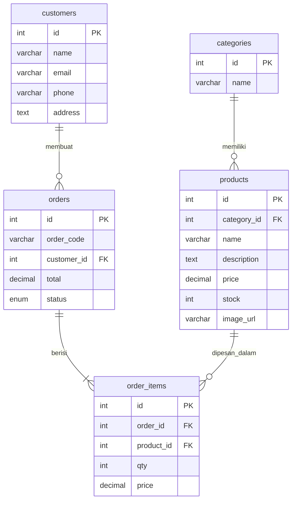
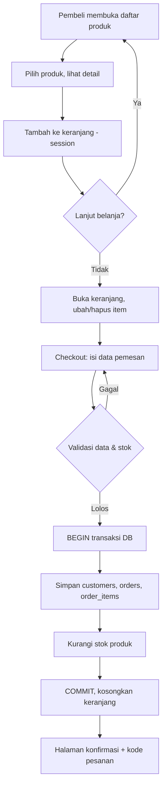

# Pasar Nusa - Web Marketplace (PHP Native + MySQLi + Bootstrap)

## A. Analisis dan Perancangan

### a. Entitas
| Entitas | Peran |
|---|---|
| categories | Pengelompokan produk |
| products | Barang yang dijual (CRUD oleh admin) |
| customers | Data pembeli saat checkout |
| orders | Header transaksi pemesanan |
| order_items | Detail barang per pesanan (menyimpan harga saat beli) |

### b. Rancangan database relasional
| Tabel | Atribut (PK **bold**, FK *italic*) |
|---|---|
| categories | **id**, name |
| products | **id**, *category_id*, name, description, price, stock, image_url, created_at |
| customers | **id**, name, email, phone, address |
| orders | **id**, order_code, *customer_id*, total, status, created_at |
| order_items | **id**, *order_id*, *product_id*, qty, price |

Relasi: categories 1-N products; customers 1-N orders; orders 1-N order_items; products 1-N order_items (orders dan products berhubungan N-M melalui order_items).

### c. ERD

Salin blok mermaid ke https://mermaid.live untuk mengekspor gambar ERD (PNG) untuk laporan.

### d. Alur transaksi


### e. Mockup UI
**Daftar produk**
```
+--------------------------------------------------+
| Pasar Nusa                     Keranjang [2] Admin|
+--------------------------------------------------+
| [ Cari produk.......] [Kategori v] [Cari]         |
| +------+ +------+ +------+ +------+               |
| |gambar| |gambar| |gambar| |gambar|               |
| |Nama  | |Nama  | |Nama  | |Nama  |               |
| |Rp xxx| |Rp xxx| |Rp xxx| |Rp xxx|               |
| |[Detail]|[Detail]|[Detail]|[Detail]               |
| +------+ +------+ +------+ +------+               |
+--------------------------------------------------+
```
**Detail produk**
```
+--------------------------------------------------+
| +-------------+  Kategori                         |
| |             |  Nama Produk                      |
| |   gambar    |  Rp 185.000                       |
| |             |  Deskripsi ...  Stok: 20          |
| +-------------+  [ qty 1 ] [Tambah ke keranjang]  |
+--------------------------------------------------+
```
**Keranjang belanja**
```
+--------------------------------------------------+
| Produk      Harga     Jumlah       Subtotal       |
| Kemeja      185.000   [2][Ubah]    370.000 [Hapus]|
| Earphone    275.000   [1][Ubah]    275.000 [Hapus]|
|                         Total      Rp 645.000     |
|                         [Lanjut ke checkout]      |
+--------------------------------------------------+
```

## B. Menjalankan lokal
1. Buat database MySQL, impor `database_local.sql (lokal) atau database_hosting.sql (InfinityFree)`.
2. Salin `config.sample.php` menjadi `config.php`, isi kredensial dan password admin.
3. Jalankan di XAMPP (`htdocs/marketplace`) lalu buka `http://localhost/marketplace`.
4. Admin: `/admin/login.php` (CRUD produk, daftar pesanan).

## C. Deployment InfinityFree
1. Daftar di infinityfree.com, buat akun hosting, catat subdomain.
2. Di Control Panel > MySQL Databases, buat database; catat host (mis. `sql123.infinityfree.com`), user, password, nama DB.
3. Buka phpMyAdmin, pilih database, tab Import, unggah `database_local.sql (lokal) atau database_hosting.sql (InfinityFree)`.
4. Di File Manager / FTP (FileZilla), unggah semua isi folder ke `htdocs/` (kecuali `.git`), lalu buat `config.php` langsung di server berisi kredensial asli.
5. Buka `https://namamu.infinityfreeapp.com` dan uji alur belanja.

## D. Publikasi GitHub
```
git init && git add . && git commit -m "Marketplace PHP native"
git branch -M main
git remote add origin https://github.com/USERNAME/marketplace.git
git push -u origin main
```
`config.php` sudah ada di `.gitignore`, jadi password tidak ikut terunggah. Periksa dengan `git status` sebelum push.

## E. Checklist laporan
- URL demo: ______  - URL GitHub: ______
- Screenshot: daftar produk, detail, keranjang, checkout, konfirmasi pesanan, admin CRUD
- Screenshot phpMyAdmin: struktur 5 tabel, isi tabel `orders` dan `order_items` setelah uji transaksi, stok produk berkurang
